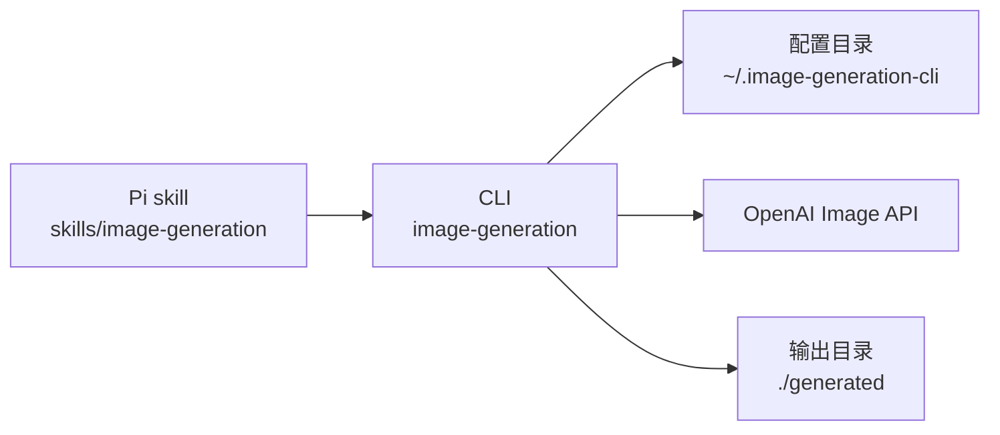

# image-generation-cli 设计

- 状态：一期已实现
- 日期：2026-11-16
- 项目路径：`D:\projects\ts\image-generation-cli`

## 1. 目标

把图片生成能力拆成两个独立部分：

- `image-generation`：TypeScript 编写的 CLI，通过 npm 全局安装，在 shell 中直接调用。
- `image-generation` skill：放在 `skills/image-generation`，通过软链接接入 Pi，只负责描述调用方式、配置位置和结果处理。

CLI 直接使用 OpenAI Image API 的 JSON 协议，不引入 OpenAI SDK，以兼容任意 OpenAI Image API 端点。

## 2. 范围

### 一期

- 文生图：`POST {apiUrl}/images/generations`
- 单轮图片编辑：`POST {apiUrl}/images/edits`
- edits 使用 `application/json`，本地图片编码为 base64 data URL
- 多 provider、多 model、默认 provider、默认 model
- 全局、provider、model 三层输出默认值，CLI 参数最高
- 配置打印与脱敏
- `.env` 密钥加载
- `init`、`doctor`、`config`、`skill path` 辅助命令
- 输出格式：png、webp、jpeg
- 结构化 JSON 输出、明确退出码、`--dry-run`
- 默认不自动重试

### 二期

- edits 的 multipart 传输，用于旧代理或超过 data URL 限制的本地图片
- gif、svg 输出及对应参数
- provider 自定义请求头

### 不包含

- Streaming、`partial_images`
- Responses API
- Multi-turn editing、`previous_response_id`
- Responses API 的灵活图片输入
- Files API 上传
- `safety_identifier`、`user`、`style`、`response_format`
- 图片解码、转码、缩放

## 3. 总体结构



```text
image-generation-cli/
├── package.json
├── package-lock.json
├── tsconfig.json
├── tsup.config.ts
├── vitest.config.ts
├── .gitignore
├── AGENTS.md
├── README.md
├── docs/
│   ├── references/
│   │   └── openai-guides-image-generation.md    # 本地资料，git 忽略
│   └── tasks/
│       └── 26-11-16-image-generation-cli/
│           └── design.md
├── src/
│   ├── cli.ts
│   ├── errors.ts
│   ├── paths.ts
│   ├── types.ts
│   ├── version.ts
│   ├── commands/
│   │   ├── common.ts
│   │   ├── generate.ts
│   │   ├── edit.ts
│   │   ├── config.ts
│   │   ├── init.ts
│   │   ├── doctor.ts
│   │   └── skill-path.ts
│   ├── config/
│   │   ├── schema.ts
│   │   ├── load.ts
│   │   ├── merge.ts
│   │   ├── redact.ts
│   │   └── secrets.ts
│   ├── api/
│   │   ├── client.ts
│   │   └── types.ts
│   ├── input/
│   │   ├── data-url.ts
│   │   └── mime.ts
│   └── output/
│       ├── files.ts
│       └── result.ts
├── tests/
│   ├── api.test.ts
│   ├── cli.test.ts
│   ├── commands.test.ts
│   ├── config.test.ts
│   ├── input.test.ts
│   └── helpers.ts
├── examples/
│   ├── config.example.json
│   └── env.example
└── skills/
    └── image-generation/
        ├── SKILL.md
        └── references/
            ├── config.md
            ├── cli.md
            └── image-api.md
```

## 4. 技术栈

- TypeScript ESM
- Node.js `>=22`
- `commander`：子命令、参数解析、`--help`
- `zod`：配置校验
- `tsup`：构建到 `dist/`
- `vitest`：测试
- `tsx`：本地开发
- 内置 `fetch`、`fs/promises`、`path`、`process.loadEnvFile`

不引入 OpenAI SDK、dotenv、multipart 编码库。

## 5. 配置

### 5.1 位置

默认配置目录：

```text
~/.image-generation-cli/
├── config.json
├── .env
└── .env.example
```

Windows 下 `~` 解析为 `%USERPROFILE%`，即 `C:\Users\<name>`。

覆盖规则：

- `IMAGE_GENERATION_HOME` 覆盖配置目录
- `--config <path>` 覆盖配置文件
- `.env` 从配置文件所在目录加载
- 进程环境变量优先于 `.env`

### 5.2 示例

```json
{
  "defaultProvider": "openai",
  "defaults": {
    "n": 1,
    "size": "auto",
    "quality": "medium",
    "background": "auto",
    "output_format": "png"
  },
  "providers": {
    "openai": {
      "apiUrl": "https://api.openai.com/v1",
      "apiKey": "${OPENAI_API_KEY}",
      "defaultModel": "gpt-image-2.6-flare",
      "defaults": {
        "quality": "high"
      },
      "models": {
        "gpt-image-2.6-flare": {
          "defaults": {
            "size": "1536x1024",
            "output_format": "webp",
            "output_compression": 90
          }
        },
        "gpt-image-2.6-sunburst": {
          "defaults": {
            "quality": "max"
          }
        }
      }
    }
  }
}
```

`.env.example`：

```dotenv
OPENAI_API_KEY=
```

### 5.3 结构

- `defaultProvider`：必填，必须存在于 `providers`
- `providers`：对象映射，key 为 provider 名称
- `defaults`：全局输出默认值，可省略
- `provider.apiUrl`：必填，API 基址，必须包含版本前缀
- `provider.apiKey`：必填，字面量或 `${ENV_VAR}` 占位符
- `provider.defaultModel`：必填，必须存在于 `models`
- `provider.defaults`：provider 级输出默认值，可省略
- `provider.models`：对象映射，key 为模型 ID
- `model.defaults`：model 级输出默认值，可省略

`defaults` 支持字段：

| 字段 | 取值 | API 默认 | 说明 |
| --- | --- | --- | --- |
| `n` | 1 至 10 | 1 | 生成张数 |
| `size` | `auto` 或 `WIDTHxHEIGHT` | `auto` | 宽高需为 16 的倍数 |
| `quality` | `low` `medium` `high` `xhigh` `max` `auto` | `auto` | `xhigh`/`max` 仅 2.5/2.6 |
| `background` | `transparent` `opaque` `auto` | `auto` | `transparent` 仅 png/webp |
| `output_format` | `png` `webp` `jpeg` | `png` | 一期支持三种 |
| `output_compression` | 0 至 100 整数 | 100 | 仅 jpeg/webp |
| `moderation` | `auto` `low` | `auto` | |
| `complexity` | `low` `medium` `high` | 模型默认 | 2.5/2.6 省略时为 `high` |

### 5.4 合并


- 按字段覆盖，对象字段递归合并
- `null` 表示删除上层继承的键，不发送给 API
- 合并完成后再做跨字段校验
- 未设置的字段不写入请求体，由 API 使用自身默认值

### 5.5 校验

- 配置采用严格校验，未知字段直接报错
- `apiUrl` 必须为 `http` 或 `https`
- `defaultProvider`、`defaultModel` 必须存在
- `models` 至少包含一个模型
- `--model` 只能选择已配置的模型
- `size` 校验 16 倍数、宽高比 1:3 至 3:1、边长不超过 3840、总像素 655360 至 8294400
- `output_compression` 仅允许 jpeg/webp
- `background: transparent` 仅允许 png/webp
- 提示词长度不超过 32000 字符

模型能力差异由 API 判定，客户端只做结构和跨字段校验。

### 5.6 密钥与脱敏

- `apiKey` 支持 `${ENV_VAR}`，生成时解析
- `config` 命令不解析环境变量
- `config` 输出把 `apiKey` 替换为 `[REDACTED]`
- `config --effective` 只输出合并后的输出参数和来源，不输出密钥
- `doctor` 只报告环境变量 set/missing，不打印值
- 错误、重试日志、`--dry-run` 输出不得包含 Authorization 头或 `.env` 内容

### 5.7 `init`

`image-generation init`：

- 创建 `~/.image-generation-cli`
- 从 `examples/config.example.json` 生成 `config.json`
- 从 `examples/env.example` 生成 `.env.example`
- 已存在的文件不覆盖
- 输出创建的文件路径
- 在 POSIX 上尽量使用 `0700` 目录权限和 `0600` 文件权限

### 5.8 `doctor`

`image-generation doctor` 检查：

- Node.js 版本
- CLI 版本
- 配置文件是否存在并可解析
- 默认 provider/model 是否存在
- `apiKey` 引用的环境变量是否存在
- 输出目录是否可写
- 打包内 skill 路径是否存在

`doctor` 不调用图片 API，不产生费用。

## 6. CLI

### 6.1 命令

| 命令 | 作用 |
| --- | --- |
| `image-generation generate` | 文生图 |
| `image-generation edit` | 图片编辑 |
| `image-generation config` | 输出脱敏配置 |
| `image-generation config --effective --provider P [--model M]` | 输出合并后的默认值及来源 |
| `image-generation init` | 初始化配置目录和示例文件 |
| `image-generation doctor` | 检查环境、配置、密钥和路径 |
| `image-generation skill path` | 输出打包内 skill 目录的绝对路径 |
| `image-generation --version` | 输出版本 |
| `image-generation --help` | 输出帮助 |

### 6.2 公共参数

| 参数 | 说明 |
| --- | --- |
| `--provider <name>` | 覆盖默认 provider |
| `--model <name>` | 覆盖默认 model |
| `--out-dir <dir>` | 输出目录，默认 `./generated` |
| `--name <base>` | 文件名前缀，默认 `image-<时间戳>-<随机串>` |
| `--force` | 允许覆盖已存在的目标文件 |
| `--size` `--quality` `--background` `--output-format` `--output-compression` `--moderation` `--complexity` `--n` | 覆盖对应默认值 |
| `--timeout <seconds>` | 单次请求超时，默认 180 |
| `--retries <n>` | 可重试错误的次数，默认 0 |
| `--dry-run` | 只打印请求 URL 与请求体，不发请求、不读密钥 |
| `--config <path>` | 指定配置文件 |

### 6.3 提示词

`generate` 和 `edit` 必须且只能提供一种提示词来源：

- `--prompt <text>`
- `--prompt-file <path>`
- `--prompt -` 从 stdin 读取

提示词按 UTF-8 读取，长度不超过 32000 字符。

### 6.4 `edit` 专用参数

| 参数 | 说明 |
| --- | --- |
| `--image <value>` | 可重复，1 至 16 个。第一张是主图 |
| `--mask <value>` | 可选，与 `--markup` 互斥 |
| `--markup <value>` | 可选，透明 PNG 标注层，与 `--mask` 互斥 |
| `--input-fidelity <high\|low>` | 可选，仅 edits 发送；`gpt-image-2` 应省略 |

`--image`、`--mask`、`--markup` 的取值支持：

- 本地路径：读取字节，按魔数识别 MIME，转成 data URL
- `http://` 或 `https://` URL：原样传给 `image_url`
- `file-...`：作为 `file_id` 传入

本地输入图片支持 png、jpeg、webp。本地 mask 和 markup 要求 PNG。尺寸、alpha 通道和格式一致性由 API 校验。

### 6.5 输出位置与文件名

默认输出目录：

```text
./generated
```

相对于 CLI 执行时的当前工作目录，目录不存在时自动创建。

默认文件名：

```text
image-YYYYMMDD-HHmmss-xxxx.<ext>
```

- `YYYYMMDD-HHmmss`：本机本地时间
- `xxxx`：4 位十六进制随机串
- `<ext>`：由实际输出格式决定，`jpeg` 使用 `.jpg`

示例：

```text
generated/image-20261116-202555-3f9a.png
generated/image-20261116-202555-3f9a.webp
```

一次生成多张时追加序号：

```text
image-20261116-202555-3f9a-1.png
image-20261116-202555-3f9a-2.png
```

`--name cat`：

- `n=1`：`cat.png`
- `n=2`：`cat-1.png`、`cat-2.png`

`--name` 中的已知图片扩展名会被去掉，最终扩展名由输出格式决定。

stdout JSON 中 `files[].path` 一律为绝对路径。stderr 默认逐个打印：

```text
saved: D:\work\generated\image-20261116-202555-3f9a.png
```

skill 要求 agent 在最终回复中列出这些绝对路径。

### 6.6 写入冲突

目标文件已存在时，默认报错退出，退出码 6。

- 写入前预检所有目标路径
- 任意一个已存在就报错
- 不覆盖任何文件，不留下部分结果
- `--force` 才允许覆盖

### 6.7 成功输出

stdout 只输出结果 JSON，进度与 `saved:` 行输出到 stderr。

```json
{
  "ok": true,
  "operation": "generate",
  "provider": "openai",
  "model": "gpt-image-2.6-flare",
  "files": [
    {
      "path": "D:/work/generated/image-20261116-202555-3f9a.webp",
      "bytes": 284512,
      "format": "webp"
    }
  ],
  "request": {
    "size": "1536x1024",
    "quality": "high",
    "background": "auto",
    "output_format": "webp",
    "output_compression": 90,
    "n": 1
  },
  "created": 1763223555,
  "requestId": "req_...",
  "usage": {
    "input_tokens": 32,
    "output_tokens": 4096,
    "total_tokens": 4128
  },
  "elapsedMs": 18432
}
```

`operation` 为 `generate` 或 `edit`。edits 的 `request` 只记录输入数量、是否使用 mask/markup 等摘要，不输出图片数据。

### 6.8 错误输出

错误时 stdout 为空，stderr 输出 JSON。

```json
{
  "ok": false,
  "error": {
    "kind": "api",
    "status": 400,
    "type": "image_generation_user_error",
    "code": "moderation_blocked",
    "message": "...",
    "moderation": {
      "stage": "input",
      "categories": ["harassment"]
    },
    "requestId": "req_..."
  }
}
```

### 6.9 退出码

| 退出码 | 含义 |
| --- | --- |
| 0 | 成功 |
| 1 | 未预期的内部错误 |
| 2 | 参数或配置错误 |
| 3 | 认证失败（401/403） |
| 4 | API 拒绝请求，含 moderation |
| 5 | 网络错误或超时 |
| 6 | 文件写入失败或目标冲突 |
| 7 | 显式启用重试后仍失败 |

### 6.10 超时与重试

- 单次请求超时默认 180 秒
- 重试默认 0 次
- 重试只针对 408、429、5xx 和网络错误
- 启用重试时遵循 `Retry-After`，使用指数退避
- `400`、认证错误、`image_generation_user_error` 不重试
- 默认行为是把错误原样交给调用者，避免重复请求产生额外费用

## 7. API 协议

### 7.1 端点

`apiUrl` 是 API 基址，例如：

```text
https://api.openai.com/v1
```

CLI 按命令拼接：

- `generate`：`{apiUrl}/images/generations`
- `edit`：`{apiUrl}/images/edits`

请求头：

```text
Content-Type: application/json
Authorization: Bearer <apiKey>
```

### 7.2 `generate` 请求体

```json
{
  "model": "gpt-image-2.6-flare",
  "prompt": "一只在雪地里提灯笼的猴子，剪纸风格",
  "n": 1,
  "size": "1536x1024",
  "quality": "high",
  "background": "auto",
  "output_format": "webp",
  "output_compression": 90
}
```

可选字段：`moderation`、`complexity`。

不发送：`stream`、`partial_images`、`response_format`、`style`、`user`、`prompt_rewriter`。

### 7.3 `edit` 请求体

```json
{
  "model": "gpt-image-2.6-flare",
  "prompt": "把背景换成雪山，保留人物和光线",
  "images": [
    { "image_url": "data:image/png;base64,<...>" },
    { "image_url": "https://example.com/reference.webp" }
  ],
  "mask": {
    "image_url": "data:image/png;base64,<...>"
  },
  "quality": "high",
  "size": "1024x1024"
}
```

使用 `markup` 时，把 `mask` 换成 `markup`，两者不能同时出现。

### 7.4 输入限制

- `images` 数量 1 至 16
- 单个 `image_url` 不超过 20,971,520 字符
- 本地图片转 data URL 后计入该限制，单文件约 15MB 以内
- 所有本地输入原始字节合计不超过 64MB
- 本地 mask/markup 要求 PNG
- mask/markup 的尺寸、alpha 通道由 API 校验
- 总请求体不包含任何流式字段

### 7.5 响应

- 必须包含 `data[].b64_json`
- 缺失 `b64_json` 时视为错误，不下载 `url`
- 解码后按输出格式写入文件
- 使用临时文件加 rename 的方式原子写入
- 保留 `created`、`usage`、`svg_usage`、`requestId`
- 不把 base64 写入 stdout 或 stderr

### 7.6 错误

- 解析 `{ "error": { ... } }`
- 保留 `status`、`type`、`code`、`message`、`moderation_details`
- 读取 `x-request-id` 或 `request-id` 响应头
- 非 JSON 错误响应截取前 500 字符作为 message
- moderation 错误包含 `moderation_stage` 和 `categories`
- 默认不自动重试

## 8. Skill

### 8.1 位置与链接

```text
skills/image-generation/
├── SKILL.md
└── references/
    ├── config.md
    ├── cli.md
    └── image-api.md
```

本机软链接：

```bash
MSYS=winsymlinks:nativestrict ln -s /d/projects/ts/image-generation-cli/skills/image-generation \
  /c/Users/Admin/.pi/agent/skills/image-generation
```

`skills/image-generation` 同时包含在 npm 包的 `files` 中。全局安装后可通过：

```bash
image-generation skill path
```

获取打包内 skill 目录的绝对路径。

### 8.2 SKILL.md

- `name`: `image-generation`
- `description`: 通过 OpenAI Image API 兼容端点生成和编辑图片
- `compatibility`: 需要 Node.js 22+ 和 `image-generation` CLI
- 正文使用中文，API 字段保留英文
- 不包含脚本
- 不写安装排查，直接按 CLI 可用编写
- 说明默认输出目录、文件名、绝对路径展示
- 说明 generate 与 edit 的调用方式
- 说明配置位置和 `.env`
- 说明错误与退出码
- 指向 `references/config.md`、`references/cli.md`、`references/image-api.md`

### 8.3 输出展示

SKILL.md 要求 agent：

- 从用户项目目录执行，或显式传 `--out-dir`
- 读取 CLI 的 JSON 输出
- 在最终回复中列出每个输出文件的绝对路径
- 不输出 base64、Authorization 或 `.env` 内容
- 生成后用图片读取工具检查结果

## 9. npm 包与安装

### 9.1 `package.json`

```json
{
  "name": "image-generation-cli",
  "version": "0.1.0",
  "type": "module",
  "bin": {
    "image-generation": "./dist/cli.js"
  },
  "files": ["dist", "skills", "examples"],
  "engines": {
    "node": ">=22"
  },
  "scripts": {
    "build": "tsup",
    "dev": "tsx src/cli.ts",
    "test": "vitest run",
    "typecheck": "tsc --noEmit",
    "prepare": "npm run build"
  },
  "dependencies": {
    "commander": "^15.1.0",
    "zod": "^4.6.7"
  },
  "devDependencies": {
    "@types/node": "^24",
    "tsup": "^9",
    "tsx": "^4",
    "typescript": "^5",
    "vitest": "^5"
  }
}
```

### 9.2 构建

- `src/cli.ts` 保留 shebang
- `tsup` 输出 ESM 到 `dist/`
- target 为 `node22`
- 生成 sourcemap
- `dist/cli.js` 可直接作为全局 bin

### 9.3 本机安装

```bash
npm install
npm run build
npm link
```

或稳定安装：

```bash
npm install -g .
```

`npm link` 让全局 `image-generation` 指向仓库，修改源码后重新构建即可生效。`npm install -g .` 是复制安装，后续改动需要重新安装。

### 9.4 发布准备

- `npm pack` 检查包内包含 `dist`、`skills`、`examples`
- 不包含 `docs/references`、测试源码、构建缓存
- `image-generation skill path` 在全局安装后可用
- 版本号与 skill 的 `compatibility` 保持一致

## 10. 测试

### 10.1 单元测试

- 配置解析与严格校验
- 三层合并、`null` 删除、来源记录
- `apiUrl` 拼接
- 脱敏
- 环境变量解析
- 文件名生成
- 退出码映射

### 10.2 集成测试

- 本地 `node:http` mock server
- `generate` 请求体、认证头、响应解析
- `edit` JSON 请求体、`images` 数组、data URL、mask/markup 互斥
- 400 moderation 错误映射
- 401/403、429、5xx、超时
- 默认不重试；显式 `--retries` 时重试
- 目标文件冲突与 `--force`
- `--dry-run` 不发请求

### 10.3 测试隔离

- 使用 `IMAGE_GENERATION_HOME` 指向临时目录
- 不读写真实 `~/.image-generation-cli`
- 不调用真实 API
- 真实 API 测试由环境变量显式开启，默认跳过

### 10.4 验收

1. `image-generation --version` 输出版本。
2. `image-generation init` 创建配置和 `.env.example`，重复执行不覆盖。
3. `image-generation config` 输出中不存在真实密钥。
4. `generate` 在 mock server 下写出文件，JSON 路径为绝对路径。
5. `edit` 使用 JSON，不发送 multipart。
6. 默认 `--retries` 为 0，失败只请求一次。
7. `--n 3` 写出 3 个文件，命名符合规则。
8. 目标文件存在时退出码为 6，`--force` 可覆盖。
9. skill 软链接可被 Pi 加载，SKILL.md 引用文件均存在。
10. `npm pack` 包含 `skills/image-generation`。

## 11. 实施顺序

1. 初始化 `package.json`、`tsconfig.json`、`tsup.config.ts`、`vitest.config.ts`
2. 配置 schema、加载、合并、脱敏
3. `init`、`config`、`doctor`
4. API 客户端、generate、edit
5. 输入 data URL、MIME 识别、文件写入、命名与冲突
6. CLI 参数、帮助、错误与退出码
7. skill 文档与软链接
8. 测试与 `npm pack` 检查

## 12. 版本库排除

`.gitignore` 包含：

```text
node_modules/
dist/
coverage/
generated/
*.tsbuildinfo

docs/references/
.pi/
.env
```
